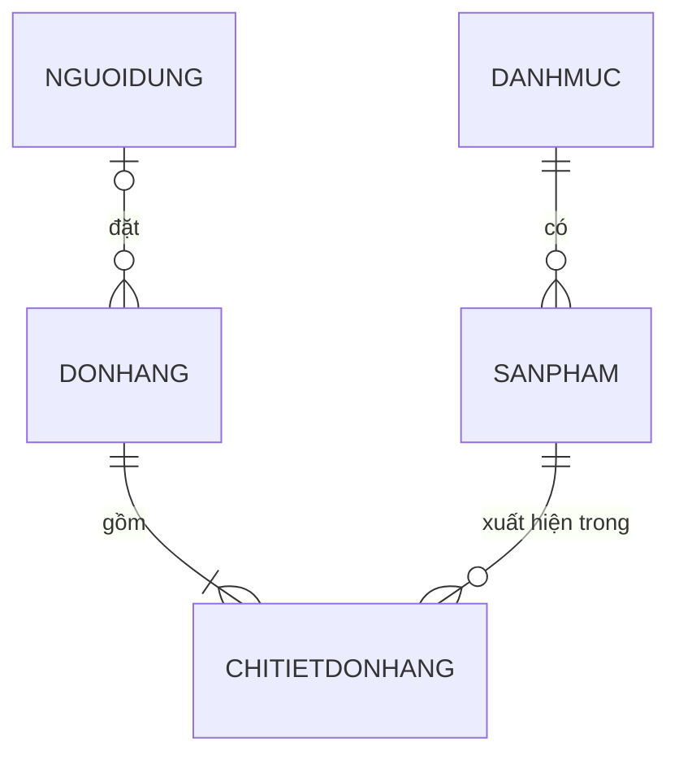
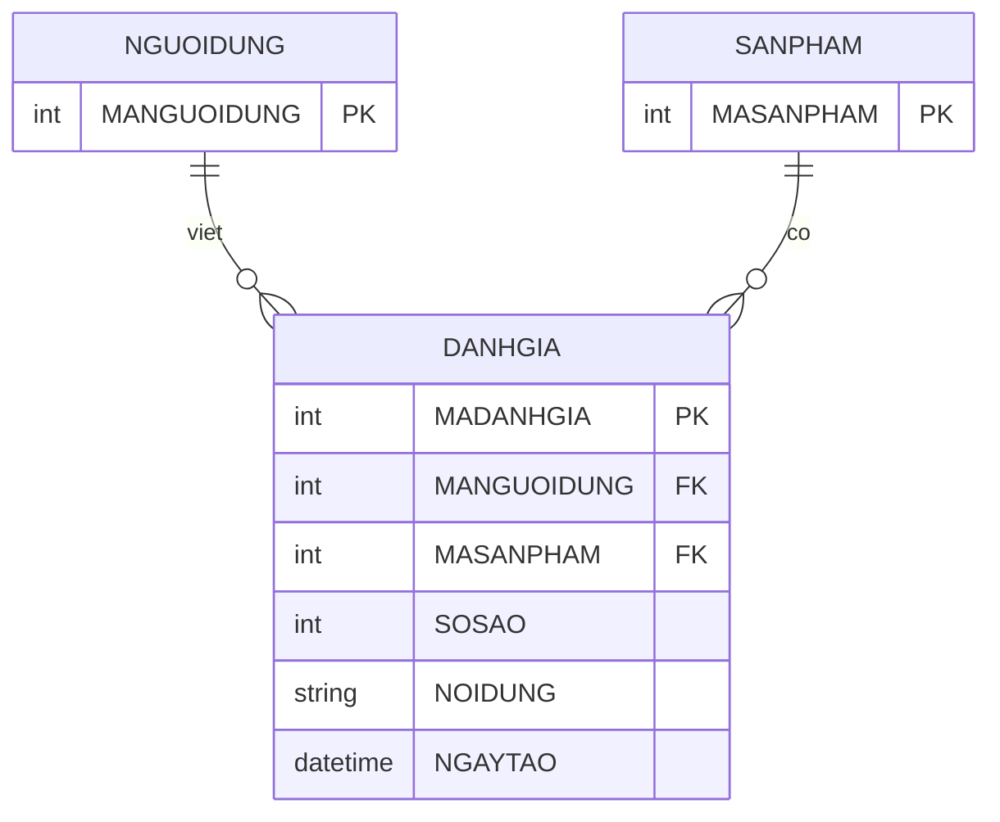

# Tài liệu database – Mini E-Commerce Store (PWD301)

Database: **SQL Server** (`EcommerceDB`), truy cập bằng Flask-SQLAlchemy.
Schema do các model trong `app/models/` quyết định, thay đổi schema thông qua Flask-Migrate (thư mục `migrations/`).

## 1. Sơ đồ quan hệ



- Danh mục **phẳng một cấp** (đã bỏ cột `MADMCHA`).
- `DONHANG.MANGUOIDUNG` có thể là `NULL`: khách chưa đăng nhập vẫn đặt hàng được.

## 2. Các bảng

### DANHMUC (model `DanhMuc`)
| Cột | Kiểu | Ghi chú |
|---|---|---|
| MADANHMUC | INT, PK | Nhập tay, không tự tăng |
| TENDM | NVARCHAR(50) | Tên danh mục |

### SANPHAM (model `SanPham`)
| Cột | Kiểu | Ghi chú |
|---|---|---|
| MASANPHAM | INT, PK, tự tăng | |
| TENSPH | NVARCHAR(200) | Tên sản phẩm |
| HINHANH | VARCHAR(500) | Link ảnh `http(s)://...`. Rỗng hoặc không phải link (vd `no-image.jpg`) thì web hiện ảnh mặc định |
| DONGIA | NUMERIC(18,2) | Đơn giá (đ) |
| MOTA | NVARCHAR(500) | Mô tả |
| SOLUONGTON | INT, mặc định 0 | Tồn kho |
| TRANGTHAISPH | INT, mặc định 1 | `1` = Đang bán (Active), `0` = Tạm ẩn (Inactive) |
| MADANHMUC | INT, FK → DANHMUC | |

### NGUOIDUNG (model `User`)
| Cột | Kiểu | Ghi chú |
|---|---|---|
| MANGUOIDUNG | INT, PK, tự tăng | |
| HOTEN | NVARCHAR(200), NOT NULL | |
| EMAIL | VARCHAR(200) | |
| SDT | VARCHAR(10) | |
| NGAYSINH | DATE | |
| PASSWORD_HASH | VARCHAR(255) | Mật khẩu đã băm, không lưu mật khẩu thô |
| ROLE | VARCHAR(20), mặc định `customer` | Vai trò (`customer`, `admin`...) |
| TRANGTHAIND | INT, mặc định 1 | Trạng thái tài khoản |

### DONHANG (model `DonHang`)
| Cột | Kiểu | Ghi chú |
|---|---|---|
| MADONHANG | INT, PK, tự tăng | |
| MANGUOIDUNG | INT, FK → NGUOIDUNG, NULL | NULL nếu khách chưa đăng nhập |
| NGAYDAT | DATE | |
| TONGGIATRI | NUMERIC(18,2) | Tổng tiền, lưu lúc đặt hàng |
| TRANGTHAI | INT, mặc định 0 | `0` Mới / chờ xử lý, `1` Đang xử lý, `2` Hoàn thành, `3` Đã hủy |
| HOTENNHAN | NVARCHAR(200) | Người nhận (từ form checkout) |
| DIACHIGIAO | NVARCHAR(300) | Địa chỉ giao hàng |
| SDTNHAN | VARCHAR(15) | Số điện thoại nhận hàng |

### CHITIETDONHANG (model `ChiTietDonHang`)
| Cột | Kiểu | Ghi chú |
|---|---|---|
| MADONHANG | INT, PK, FK → DONHANG | |
| MASANPHAM | INT, PK, FK → SANPHAM | |
| SOLUONG | INT | |

Khóa chính ghép `(MADONHANG, MASANPHAM)`: một sản phẩm chỉ xuất hiện một lần trong một đơn.

### Quan hệ trong code
- `DanhMuc.sanpham_list` ↔ `SanPham.danhmuc`
- `User.donhang_list` ↔ `DonHang.user`
- `DonHang.chitiet_list` ↔ `ChiTietDonHang.donhang`
- `ChiTietDonHang.sanpham`

## 3. Quy tắc nghiệp vụ

- **Chỉ sản phẩm Active (`TRANGTHAISPH = 1`)** hiện ở trang shop. Trang chi tiết của sản phẩm Inactive trả 404. Trang admin vẫn thấy tất cả.
- **Giá và tồn kho không âm:** được kiểm tra khi thêm/sửa sản phẩm trong admin (chưa có CHECK constraint ở database).
- **Hết hàng** (`SOLUONGTON = 0`): hiện nhãn "Hết hàng", không cho thêm vào giỏ. Khi đặt hàng, hệ thống kiểm tra lại tồn kho và trừ kho.
- **Sort "Mới nhất"** = `MASANPHAM` lớn nhất trước (chưa có cột ngày tạo).
- **Tìm kiếm** theo tên và mô tả, không phân biệt hoa thường; ký tự `%`, `_`, `[` được tìm theo nghĩa đen.
- **Lọc giá** `min_price` / `max_price`: giá không hợp lệ bị bỏ qua kèm cảnh báo; nếu min lớn hơn max thì hai giá trị tự đổi chỗ.
- Logic truy vấn sản phẩm nằm trong `app/services/product_service.py` (`get_products`, `get_product_by_id`, `get_categories`, `is_available`). Route và API nên gọi các hàm này thay vì tự viết query.

## 4. Cài đặt database

### 4.1. Cấu hình kết nối
Tạo file `.env` ở thư mục gốc (file này không được commit), ví dụ với SQL Server Express dùng Windows Authentication:

```
DATABASE_URL=mssql+pyodbc://@localhost\SQLEXPRESS/EcommerceDB?driver=ODBC+Driver+17+for+SQL+Server&trusted_connection=yes
```

Sửa tên máy, tên instance, tên driver cho đúng máy của bạn. Nếu không có `DATABASE_URL`, ứng dụng dùng SQLite `dev.db` (chỉ để thử).
Tạo sẵn database trống `EcommerceDB` trong SSMS trước.

### 4.2. Database mới (khuyên dùng)
```
python seed.py
```
Lệnh này tạo các bảng từ model, đánh dấu migration ở bản mới nhất và thêm dữ liệu mẫu (4 danh mục, 20 sản phẩm). Chạy lại nhiều lần không bị trùng dữ liệu.
Muốn xóa sạch và làm lại từ đầu: `python seed.py --reset` (có hỏi xác nhận).

### 4.3. Database đã có sẵn từ các tuần trước
```
flask db upgrade
flask db check
```
`flask db check` phải báo `No new upgrade operations detected`.

### 4.4. Cách khác: chạy script SQL
Chạy `seed_data.sql` trong SSMS trên database trống, sau đó chạy `flask db stamp head` (nếu thiếu bước này, `flask db upgrade` sẽ báo lỗi bảng đã tồn tại).

## 5. Migration

Lịch sử migration (`migrations/versions/`):

| Revision | Nội dung |
|---|---|
| `f14dcd86bf53` | Nới `SANPHAM.HINHANH` lên 500 ký tự |
| `b2a434abe7a9` | Thêm `HOTENNHAN`, `DIACHIGIAO`, `SDTNHAN` vào `DONHANG` |
| `c562dfbd1758` | Đổi `DONHANG.TONGGIATRI` sang NUMERIC(18,2), `NGUOIDUNG.SDT` sang VARCHAR(10) |

Khi đổi model:
```
flask db migrate -m "mô tả ngắn"
```
Mở file mới trong `migrations/versions/` để kiểm tra (không được có `drop_table` ngoài ý muốn), sau đó:
```
flask db upgrade
flask db check
```
Hai bảng `DANHMUC_BACKUP` và `SANPHAM_BACKUP` (bản sao lưu cũ, không thuộc model) đã được bỏ qua trong `migrations/env.py`, nên Alembic không đề xuất xóa chúng.

## 6. Lưu ý với SQL Server

- Phân trang bắt buộc có `ORDER BY`, và **một cột không được xuất hiện hai lần** trong `ORDER BY`.
- Cột tiếng Việt dùng `Unicode` (NVARCHAR) trong model để lưu có dấu.
- Dùng `Numeric(18,2)` thay cho `MONEY` để model và database khớp nhau.

## 7. Hạn chế đã biết

- `CHITIETDONHANG` không lưu đơn giá tại thời điểm mua, nên đổi giá sản phẩm sẽ làm thành tiền từng dòng trong đơn cũ hiển thị theo giá mới (`TONGGIATRI` của đơn vẫn giữ nguyên giá lúc đặt).
- Chưa có cột ngày tạo cho sản phẩm.
- Chưa có CHECK constraint cho giá và tồn kho; việc kiểm tra hiện nằm ở tầng form admin.

## Bảng DANHGIA (đánh giá sản phẩm, quan hệ M:N User - Product)

Bảng liên kết thật sự giữa `NGUOIDUNG` và `SANPHAM`: một user đánh giá nhiều sản phẩm,
một sản phẩm được nhiều user đánh giá.

| Cột | Kiểu | Ràng buộc |
|---|---|---|
| MADANHGIA | INT | PK, tự tăng |
| MANGUOIDUNG | INT | NOT NULL, FK -> NGUOIDUNG.MANGUOIDUNG |
| MASANPHAM | INT | NOT NULL, FK -> SANPHAM.MASANPHAM |
| SOSAO | INT | NOT NULL, CHECK (SOSAO BETWEEN 1 AND 5) |
| NOIDUNG | NVARCHAR(1000) | NULL |
| NGAYTAO | DATETIME | NOT NULL |

- `UNIQUE (MANGUOIDUNG, MASANPHAM)` (tên `UQ_DANHGIA_USER_SP`): mỗi user chỉ đánh giá 1 lần cho mỗi sản phẩm.
- `CHECK` tên `CK_DANHGIA_SOSAO`: chặn điểm ngoài khoảng 1-5.
- Migration: `b9953ac12c5e_add_danhgia_review_table.py` (sau `c562dfbd1758`).
- Policy hiện tại: chưa yêu cầu đã mua hàng mới được đánh giá (chờ nhóm xác nhận).

